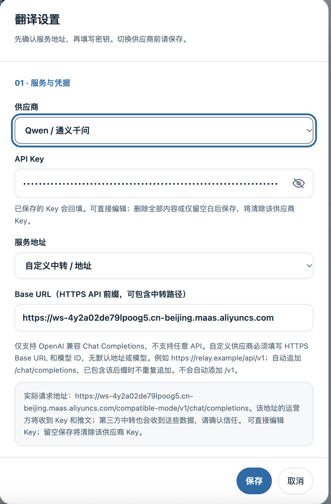
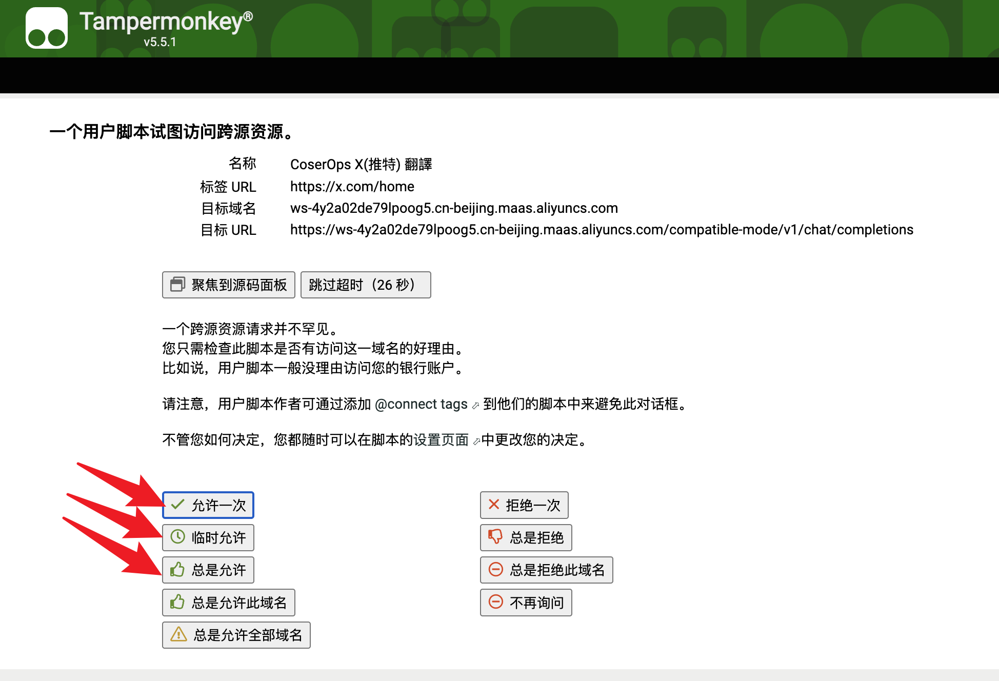
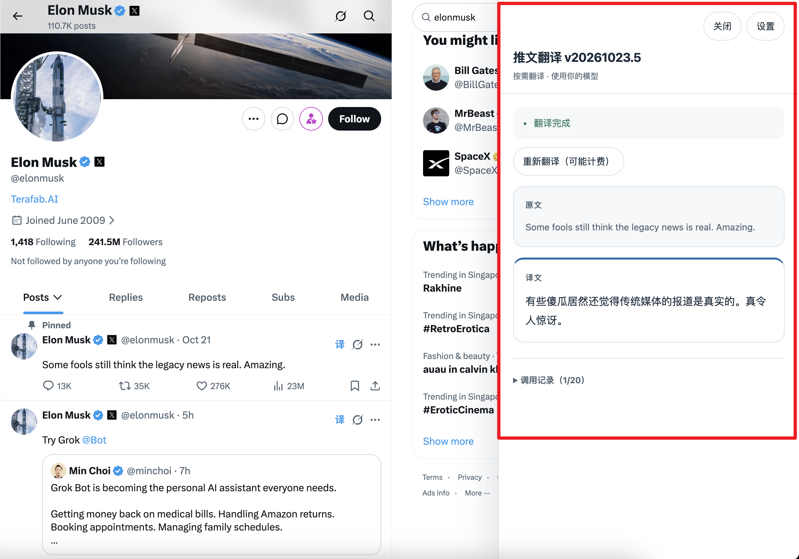

# CoserOps X(推特) 翻译

[更多 CoserOps 项目](https://github.com/orgs/coserops/repositories) · [联系作者：X @coserops](https://x.com/coserops)

在 X / Twitter 的推文 **Grok 按钮左侧**添加「译」按钮，点击后在右侧面板阅读原文和译文。使用自己的 API Key，直连所选供应商或可信的 OpenAI 兼容服务；目标语言自动跟随浏览器首选语言。

这是独立的 [Tampermonkey 用户脚本](./x-translator.user.js)，没有项目后端，使用时不需要 Node.js、构建或启动服务。支持按需翻译、本地同语言跳过、持久翻译缓存及调用诊断，不会自动批量翻译时间流。

## 目录

- [获取与安装](#获取与安装)
- [快速开始](#快速开始)
- [功能与支持范围](#功能与支持范围)
- [配置与使用](#配置与使用)
- [目标语言与同语言跳过](#目标语言与同语言跳过)
- [本地翻译缓存](#本地翻译缓存)
- [费用、数据与隐私](#费用数据与隐私)
- [常见问题与反馈](#常见问题与反馈)
- [开发与维护](#开发与维护)
- [许可证](#许可证)
- [附录：模型推荐与报价参考](#附录模型推荐与报价参考)

## 获取与安装

普通用户只需要浏览器、Tampermonkey，以及所选 API 服务的账号和 Key；无需 Node.js 或自建后端。

1. 安装并启用最新版 [Tampermonkey（篡改猴）](https://www.tampermonkey.net/)，按浏览器提示开启用户脚本权限。
2. 打开 [**CoserOps X(推特) 翻译的 Greasy Fork 发布页**](https://greasyfork.org/zh-CN/scripts/601758-coserops-x-%E6%8E%A8%E7%89%B9-%E7%BF%BB%E8%AF%91)，点击 **「安装此脚本」**。
3. 在 Tampermonkey 弹出的安装页面确认安装并启用脚本。
4. 打开或刷新 [X 首页](https://x.com/home)。符合条件的推文会在 Grok 按钮左侧出现「译」；没有出现时参见[常见问题](#常见问题与反馈)。

脚本可通过 Greasy Fork 安装；当前源码的更新与下载地址指向 GitHub `main` 分支的原始脚本，项目主页指向 GitHub 仓库。

**更新脚本**：使用当前源码安装时，Tampermonkey 根据脚本中的 `@updateURL` 和 `@downloadURL` 从 GitHub 检查并下载更新；发布新版本时需递增 `@version`。通过 Greasy Fork 安装的版本以其实际元数据为准，也可回到同一发布页安装更新。自动检查与安装取决于 Tampermonkey 设置及有效的脚本更新信息，不保证发布后立即自动更新。

本文描述**当前仓库源码**；Greasy Fork 上的已发布版本可能滞后，实际可用功能以安装版本为准。

## 快速开始

> 首次调用会把推文正文发送给所选 API 服务，可能计费；请先核对服务地址和账户权限。缓存默认开启，会在设备上持久保存原文与译文，不希望保留时请先在设置中关闭。

### 第一步：配置翻译服务

安装脚本后，在 X 页面打开篡改猴菜单，选择 **「X 翻译：设置 API Key / 模型」**。也可以从翻译面板右上角的 **「设置」** 进入。

选择供应商、服务地址及账号实际可用的模型，**先确认地址，再填写自己的 API Key**，最后点击 **「保存」**。检查只读的「浏览器语言」；如需改变译文语言，调整浏览器首选语言并刷新页面。

下图以 Qwen / 通义千问为例，其他供应商的配置流程类似。**截图中的工作空间地址仅用于演示，请使用自己服务控制台提供的地址和对应 Key，不要照抄。** 预设模型仅为配置入口，不保证当前账号可用。



### 第二步：点击「译」，按需确认请求权限

打开首页时间流、个人主页或帖子详情，找到想读的外语推文或评论，点击它的 **Grok 按钮左侧「译」**。下方第三步的截图展示了按钮位置。

首次向所选服务发送请求时，篡改猴可能弹出如下跨源访问确认页。核对 **「目标域名」和「目标 URL」** 是否属于你刚配置的服务，确认后可选择 **「允许一次」** 完成本次请求。只有确认长期信任该目标时，再选择相应的持续允许选项；无需选择「总是允许全部域名」。如果地址与配置不符，拒绝请求并返回设置检查。



此提示是否出现取决于篡改猴版本和已有授权。若确认权限期间请求已超时，返回翻译面板点击「重试」。

### 第三步：对照原文与译文

请求成功后，右侧面板显示 **「翻译完成」**，下方分别展示原文和译文。下图是在个人主页翻译一条推文的效果：左侧点击「译」，右侧直接阅读结果，无需离开当前页面。



继续读评论时，点击另一条评论旁的「译」即可查看对应内容；想回头看某条推文，再点它的「译」，匹配到本地缓存时直接显示结果，不发起新的翻译请求。

面板右上角可打开「设置」或「关闭」，失败后可「重试」。**「重新翻译（可能计费）」会发起新请求**，仅在确实需要新译文时使用。同语言正文可能直接显示「原文已是浏览器语言，未发送请求」，这是正常的跳过行为。

也可以点击页面右下角的 **「译」悬浮按钮**，直接打开翻译面板，查看已有内容或进入设置，不会自动发送翻译请求。按钮在各页面均可用；识别到右下角的 Grok 大按钮时，会显示在它上方，否则使用默认右下角位置。

## 功能与支持范围

脚本仅匹配 `https://x.com/*` 和 `https://twitter.com/*`，不在 iframe 内运行。

| 页面 | 支持范围 |
| --- | --- |
| 首页 `/`、`/home` | For you / Following 时间流 |
| 帖子详情 `/<用户名>/status/<数字ID>`、`/i/web/status/<数字ID>` | 主帖及下方可识别的评论 |
| 个人主页 `/<用户名>` | 主页推文，以及 `/with_replies`、`/media`、`/likes`、`/highlights`、`/articles` 标签内可识别的推文 |

- **每条推文必须有自己可识别的 Grok 按钮**：脚本根据按钮的 `aria-label`、`title` 或 `data-testid` 中的 Grok 语义定位，不会改插到正文或底部工具栏。不要求使用 xAI 作为翻译供应商。
- 首页若已渲染选中标签，只识别 `For you`、`Following`、`为你推荐`、`推荐`、`正在关注`、`关注`；其他语言或自定义标签会保守跳过。未渲染标签时按首页路径判断。此标签限制不适用于详情与个人主页。
- 搜索、通知、设置、关注者列表等页面不添加推文旁的「译」按钮，但仍可使用右下角入口打开面板；详情的 `/photo/...` 等额外路径不在支持范围内。个人主页用户名按 1–15 位英文字母、数字或下划线识别，并排除应用保留路由。
- 仅提取当前推文自己的正文，保留换行与 emoji 替代文本；不翻译个人简介、文章正文、图片、视频或链接预览。引用卡片与嵌套推文不单独添加按钮，也不混入引用正文。
- 支持动态加载、Grok 延后出现及推文节点复用，但依赖 X 的页面结构；登录状态、A/B 实验或 DOM 更新可能影响识别。

## 配置与使用

界面沿用仓库 Logo 的深海蓝绿（`#0C3345`）与青柠绿（`#C7E76B`），统一翻译面板、设置窗口和悬浮入口；Logo 内嵌于脚本，不额外请求图片或字体。原文与译文采用分层阅读卡片，版本号独立显示。面板适配窄屏、设备安全区域及系统浅色/深色偏好，尊重系统减少动态效果设置。设置内可用 Tab / Shift+Tab 导航、Escape 取消；焦点位于翻译面板内时，Escape 关闭面板并返回对应推文按钮。

### 供应商、模型和地址

每个供应商分别保存 Key、模型和 Base URL。切换供应商前先「保存」，否则未保存的输入不会保留。已有配置不会被新预设强制覆盖；不在预设列表中的旧模型显示为「自定义模型」。

### 内置配置

以下是**当前代码中的默认值**，不是经过实时可用性验证的模型清单：

| 供应商 | 新配置默认模型 | 默认 Base URL |
| --- | --- | --- |
| DeepSeek | `deepseek-flash` | `https://api.deepseek.com/v1` |
| Qwen / 通义千问 | `qwen-mt-flash` | `https://dashscope.aliyuncs.com/compatible-mode/v1` |
| Google Gemini API | `gemini-3.5-flash-lite` | `https://generativelanguage.googleapis.com/v1beta/openai` |
| OpenAI GPT | `gpt-6-luna` | `https://api.openai.com/v1` |
| xAI Grok | `grok-4-1-fast-non-reasoning` | `https://api.x.ai/v1` |
| 自定义 / OpenAI 兼容 | 无，必须填写 | 无，必须填写 |

Qwen 的「服务地址」还提供 **官方新加坡（国际）**：`https://dashscope-intl.aliyuncs.com/compatible-mode/v1`。Google 使用 [Gemini 的 OpenAI 兼容接口](https://ai.google.dev/gemini-api/docs/openai)及 Gemini API Key，不是 Cloud Translation 协议。

### 自定义服务与地址规则

所有供应商均可选择 **自定义中转 / 地址**；独立的 **自定义 / OpenAI 兼容** 供应商则有自己的配置，不覆盖其他供应商。选择「自定义模型」后填写服务实际支持的「自定义模型 ID」（最长 120 字符）。脚本不查询模型列表、不探测地址，也不会自动切换供应商。

仅支持**非流式 OpenAI 兼容 Chat Completions**，不是任意翻译 API。保存前核对界面的「实际请求地址」：

| 填写的 Base URL | 实际请求地址 |
| --- | --- |
| `https://relay.example/api/v1` | `https://relay.example/api/v1/chat/completions` |
| `https://relay.example/api/v1/chat/completions` | 保持完整地址，不重复追加 |
| `https://dashscope.aliyuncs.com` | `https://dashscope.aliyuncs.com/compatible-mode/v1/chat/completions` |

末尾斜杠会移除；通常只追加 `/chat/completions`，**不会自动补 `/v1`**。例外是 `dashscope.aliyuncs.com`、`dashscope-intl.aliyuncs.com` 和 `*.maas.aliyuncs.com`：只填根地址或 `/chat/completions` 时，会补为 `/compatible-mode/v1/chat/completions`；已保存的此类配置也适用，其他自定义路径不改写。

地址必须使用 HTTPS，可包含端口和路径；拒绝 URL 用户名/密码、空白、反斜杠、查询参数和片段。编辑地址会清空 Key 输入框；地址变更后必须重新输入明确用于新目标的 Key，或留空保存以清除 Key。

阿里云工作空间地址与 Key 应从对应地域控制台获取。例如工作空间地址可能采用 `https://<实际工作空间ID>.eu-central-1.maas.aliyuncs.com/compatible-mode/v1`，占位符不可照抄。请核对[地域说明](https://www.alibabacloud.com/help/en/model-studio/regions)及[法兰克福接入文档](https://www.alibabacloud.com/help/en/model-studio/germany-frankfurt-global)；地址补全不代表模型、地域权限或 Key 已验证，法兰克福报价也不能套用到北京或新加坡。

### API Key 的保存与清除

- 打开设置或切换供应商会回填其已保存 Key，默认隐藏；眼睛按钮可显示/隐藏，关闭设置会清空表单中的值。
- 可直接编辑 Key；**删除全部内容或只留空白后保存，会清除该供应商 Key**。模型与地址仍须有效，空 Key 可以保存但不能发起新请求。
- 配置存储读取或写入失败会阻止翻译，请按提示重新保存。多项保存不是事务，失败时可能仅部分写入。
- 密码框仅遮挡显示，不等于加密或页面隔离；请先阅读下方隐私说明。

## 目标语言与同语言跳过

「浏览器语言」只读，取 `navigator.languages` 中第一个非空字符串；没有可用项时回退到 `navigator.language`。不使用 X 界面语言，也不沿用旧版手动目标语言设置。

语言标签经 `Intl.Locale` 规范化并保留地区；中文按脚本/地区区分简繁，显式脚本优先，泛 `zh` 按默认 Hans 处理。修改目标语言请调整**浏览器首选语言**，必要时刷新或重启浏览器。语言缺失或无效时不发送请求，但仍可保存凭据；收到浏览器 `languagechange` 事件时会取消当前请求、清除旧译文，下次翻译使用新语言。

### Qwen-MT 限制

所有以 `qwen-mt-` 开头的模型 ID（不限供应商，包括自定义版本名）使用单条 user 原文及 `translation_options`，源语言为 `auto`，目标映射为模型语言名；不发送 system 消息。中转必须透传这些字段，改成其他模型别名时需由服务方适配协议。

当前代码按 92 种目标语言表校验 MT，`qwen-mt-lite` 及其带后缀版本限于其中 31 种。不支持浏览器首选语言时会报错，**不会改选第二偏好语言**；请换支持该语言的 MT 模型或普通聊天模型。普通聊天模型使用 system + user 翻译提示及有效 BCP-47 目标标签，不受此 MT 表限制，但实际能力仍由服务决定。源语言支持范围、token 配额请核对 [Qwen-MT API](https://www.alibabacloud.com/help/en/model-studio/qwen-mt-api)与[语言表](https://www.alibabacloud.com/help/en/model-studio/machine-translation)，前端字符上限不保证满足服务端 token 限制。

### 什么时候不会发送请求

普通翻译先尝试缓存；未命中时，脚本参考**当前正文自己的 `lang`** 与文字特征进行保守判断，不使用网页或引用卡片的语言。较有把握为同语言时显示：

> 原文已是浏览器语言，未发送请求

此时不需要 Key，也不产生本次 API 费用或调用记录。可点击 **强制翻译**，仅本次绕过同语言判断与缓存，使用已保存配置请求，可能计费。

英语等地区变体可视为同语种；中文需明确简繁标签，泛 `zh` 不作为跳过简繁转换的依据。短句、未知标签、混合文字通常照常请求；无标签时仅对部分日文、韩文采用文字线索，不把拉丁字母直接当英语，也不凭汉字猜语言。这不是完整语言检测器，同文字体系的错误标签仍可能误判；必要时强制翻译。强制请求失败后的普通「重试」会重新判断。

## 本地翻译缓存

设置中 **本地翻译缓存** 默认开启，最多 **20 条**，可选择 **10 / 20 / 50 / 100** 条，按最近最少使用（LRU）淘汰。

- **启用缓存（关闭将清空）**、**最多保留条数**、**清空翻译缓存**均立即生效，独立于凭据的「保存 / 取消」。降低容量立即淘汰；关闭前会确认，确认后删除已存原文与译文，取消确认则不改变设置。
- 命中显示 **已读取缓存**，不发送新请求，也不新增调用记录。原文全文、正文语言提示、浏览器目标语言（含地区）、供应商、模型、规范化 Endpoint 及翻译规则版本均须一致；更换 Key 本身不会使缓存失效，清除 Key 后仍可读取匹配缓存。
- 成功或命中后可点击 **重新翻译（可能计费）**，仅本次绕过缓存与同语言跳过，要求有效 Key；下一次普通点击仍可使用缓存。
- 原文、译文、配置身份及完成/最近使用时间**非加密持久保存在篡改猴存储中**。没有历史列表、过期时间（TTL）或云同步保证。不想在设备保留文本时请关闭缓存；清空缓存不清除 Key 或调用记录。
- 单条最多 **256 KiB**，总计最多 **2 MiB**，按序列化 JSON 的 UTF-8 字节计算，因此实际条数可能低于所选容量。超大单条仍显示译文但不缓存，不截断译文。
- 缓存损坏或存储失败不阻止新的翻译请求；译文仍可显示并附警告，可在设置中清空恢复。只缓存当前请求的有效成功结果；失败、取消、迟到响应及同语言跳过不写入缓存。

缓存不保存 Key、请求对象或原始响应，写入前对本页已知凭据脱敏；这不是通用隐私检测。清空/关闭会阻止先前未完成请求重新填入；跨标签页读改写并非原子事务，同时操作仍可能竞态覆盖，脚本管理器配额也可能导致保存失败。

## 费用、数据与隐私

- **主动翻译可能计费**：正文及目标语言信息发送到所选地址，按该服务的账户、模型和计费规则收费。缓存命中和本地跳过不发出本次请求；强制翻译、重新翻译、重试可能增加费用。没有自动重试或后台批量请求。
- 单次原文最多 **20,000 字符**，超时 **30 秒**；响应正文最多 **500,000 字符**，必须为非流式 JSON，且 `choices[0].message.content` 是非空字符串。字符数按 JavaScript 字符串长度计算，不是 token 数。
- 后点击优先；关闭面板、保存设置、离开支持页面或浏览器语言更新会使旧请求失效。**取消不保证服务端停止处理或停止计费**，译文也不保证准确。
- Key 在篡改猴独立脚本存储中，**不是加密保险箱**。设置打开后回填到页面 DOM 的输入框，同页面代码或扩展可能读取已回填或正在输入的 Key。仅在可信的浏览器、页面和扩展环境使用。
- 请求使用 `anonymous: true`，不携带 X Cookie；所选官方服务或中转会收到 Key 和正文，其数据处理政策适用。本项目没有中转后端，但这不等于数据不离开设备。
- 为支持自定义域名，脚本使用 `@connect *`；篡改猴可能提示域名授权，请核对实际目标，**不要向不信任的中转提供官方 Key**。
- 请求设定 `redirect: 'error'` 并检查响应最终 URL 的 origin；旧版或其他脚本管理器可能忽略重定向选项，而最终 URL 检查发生在请求之后，不能保证阻止凭据被转发。请用最新版 Tampermonkey 和无需重定向的可信 HTTPS 地址。
- 原文/译文按文本显示，不执行返回的 HTML。诊断与译文会隐藏本页已知 Key，但脱敏不能保证去除服务消息中的其他隐私；不要把它当通用保密措施。

## 常见问题与反馈

### 查看调用记录

在右侧面板展开 **调用记录**，查看本页最近 **20 次**请求尝试，最新在前。记录含脚本版本、供应商、完整 Endpoint、模型、浏览器语言、原文字符数、时间/耗时、HTTP 状态、错误类型、脱敏消息与 Request ID（若提供）。校验失败、缓存命中、本地跳过不新增记录。

记录仅在当前页面内存中，刷新即丢失；**清空调用记录**不清空翻译缓存，也不取消请求。不保存原文、完整请求体、Key 或原始响应；仅提取限长 JSON 错误消息和白名单请求 ID，HTML 错误页不展示正文。分享前仍应自行检查敏感信息。

### 常见问题

| 现象 | 建议检查 |
| --- | --- |
| 没有「译」按钮 | 脚本是否启用、网址/首页标签是否支持、该推文本身是否有带可识别标签的 Grok 按钮；刷新后仍无按钮，可能是 X DOM 变化 |
| 提示配置或存储错误 | 重新保存有效供应商、模型、HTTPS 地址；确认篡改猴存储权限。清空缓存不能修复凭据存储错误 |
| 401 / 403 | Key 是否有效、是否匹配服务地址及地域、账号是否具备模型权限 |
| 404 | 对照记录中的 Endpoint 检查前缀、中转路径、`/chat/completions` 与模型 ID；不能仅凭 404 断定是路径还是模型问题 |
| 429 | 核对服务额度、余额及频率限制；避免连续重新翻译 |
| 网络失败 / 30 秒超时 | 检查连接、篡改猴跨域授权、地址是否重定向以及服务状态 |
| 无效响应 | 确认接口提供非流式 Chat Completions JSON、模型可用且响应未超限 |
| 浏览器语言 / Qwen-MT 不支持 | 调整浏览器首选语言或换支持该语言的模型；必要时刷新浏览器 |
| 缓存警告 | 在设置中「清空翻译缓存」后重试，检查脚本管理器存储配额与权限 |

### 如何反馈

联系作者：[X @coserops](https://x.com/coserops)。翻译面板底部和设置窗口底部也提供联系入口，点击会在新标签页打开作者主页。联系入口采用加大字号与持续环绕圆角边框的青柠光点；系统开启“减少动态效果”时停止动画，不支持运动路径的浏览器显示静态光点。

脚本相关问题可从[项目仓库](https://github.com/coserops/coserops-x-translator)查看可用的反馈入口；若仓库已启用 Issues，可在那里提交。请提供浏览器与 Tampermonkey 版本、脚本管理器版本号及面板显示版本、页面类型、复现步骤、预期/实际结果，以及自行检查过的脱敏错误信息。不要提交 Key、访问令牌、完整私密配置或敏感推文。

接口权限、额度与模型可用性问题请先联系所选服务方，提供脱敏后的 Endpoint、模型、HTTP 状态及 Request ID。完整地址也可能含私有工作空间信息，分享前请删去。脚本没有在线验证过所有预设模型，模型无效时请填写账号实际可用的 ID。

## 开发与维护

最终用户无需安装开发依赖。维护需要 **Node.js >= 22** 和 npm；下载或克隆项目源码后，在包含 `package.json` 的仓库根目录运行以下命令。直接编辑根目录单文件，无需打包；唯一声明的开发依赖为 jsdom。

```sh
npm ci           # 首次安装或按锁文件恢复依赖
npm run check    # node --check：脚本语法检查
npm test         # node --test：模拟 DOM / GM API 回归测试
```

依赖已安装时不必重复 `npm ci`。测试位于 [`tests/userscript.test.cjs`](./tests/userscript.test.cjs)，覆盖页面注入、配置、语言判断、请求、缓存及诊断等行为；模拟测试不能替代真实登录 X 页面、扩展网络/重定向实现或付费 API 验证。

发布前应核对脚本元数据 `@version` 与面板使用的 `SCRIPT_VERSION`，确保两者一致。凭据和配置使用 `x-direct.v1.*` 存储键，缓存独立使用 `x-direct.v1.translation-cache`；修改存储结构时注意兼容已有数据。

## 许可证

当前仓库未找到许可证文件，`package.json` 和用户脚本元数据也未声明许可证，授权范围尚未明确。公开源码不等于允许任意使用、复制或再分发；有相关需求时请先向维护者确认。第三方 API 服务费用和使用条款另行适用。

## 附录：模型推荐与报价参考

保留以下用户提供的推荐和报价供参考：**计费单位未注明、非实时价格、模型开放情况与价格未验证**，不得推定为每百万 token，也不能直接跨币种比较。定位和语言数为原始推荐数据，不是实测结论；价格不参与代码逻辑。请以实际账号、地域、时段及官方账单为准，特别核对 DeepSeek 非高峰条件。

| 供应商 / 区域条件 | 模型 | 定位 | 语言数 | 输入价格 | 输出价格 |
| --- | --- | --- | --- | --- | --- |
| Qwen / 法兰克福 / 人民币 | `qwen-mt-lite` | 经济型：极速、低成本 | 31 | ¥0.60 | ¥1.60 |
| Qwen / 法兰克福 / 人民币 | `qwen-mt-flash` | **首选**：日常平衡 | 92 | ¥0.70 | ¥1.95 |
| Qwen / 法兰克福 / 人民币 | `qwen-mt-plus` | 高质量：正式、专业 | 92 | ¥1.80 | ¥5.40 |
| Google Gemini API / 美元 | `gemini-3.1-flash-lite` | 最低成本 | 未提供 | $0.25 | $1.50 |
| Google Gemini API / 美元 | `gemini-3.5-flash-lite` | **首选** | 未提供 | $0.30 | $2.50 |
| Google Gemini API / 美元 | `gemini-3.8-flash` | 高质量候选 | 未提供 | $0.75 | $3.75 |
| DeepSeek / 非高峰 / 美元 | `deepseek-flash` | **首选** | 未提供 | $0.15 | $0.60 |
| DeepSeek / 非高峰 / 美元 | `deepseek-v4-pro` | 高质量候选 | 未提供 | $0.66 | $1.98 |
| OpenAI / 美元 | `gpt-6-luna` | **首选** | 未提供 | $0.10 | $0.50 |
| xAI Grok | `grok-4-1-fast-non-reasoning` | 保留原默认推荐 | 未提供 | 未提供 | 未提供 |
| xAI Grok | `grok-4-1-fast-reasoning` | 保留原备选 | 未提供 | 未提供 | 未提供 |
